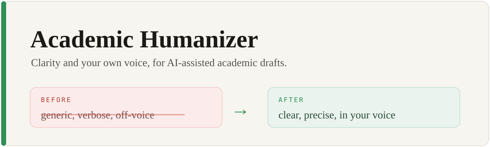

<div align="center">



[](LICENSE)
&nbsp;
&nbsp;
&nbsp;

</div>

## 我们为什么做这个

我们中不少人要写大量论文和基金申请书，团队也开始用 AI 协助起草。问题在于，AI 辅助写出的草稿千篇一律又啰嗦，开口就是 "In recent years..."，措辞虚高，句子还拖得很长。它们还会偏离作者本人的文风，丢掉学术写作所依赖的精确性。

市面上有一些叫 "humanizer"（去AI味工具）的产品，但都是为博客和营销文案设计的。拿去处理一篇论文或 NSF 申请书，它会把精确性连同其他东西一起抹平。学术写作赖以为生的严谨措辞，最先被牺牲掉。

于是我们自己做了一套。在校准时，我们让 AI 把它自己写的草稿和团队已录用论文、已获资助申请书逐条对比，再人工逐项核对差异。没什么花哨的，也不是为了糊弄评审、击穿检测器或硬塞虚假新意。我们只是希望 AI 辅助草稿能读起来清晰、用作者本人的声音说话，而其中的数字、引用和论断都原封不动地保留。

## 伦理与披露

这是一个用于提升清晰度和文风的编辑辅助工具，依据作者本人已获接受的过往作品进行校准。它不会生成发现、捏造数据，也不会改动引用，更不是为规避 AI 使用检测而设计。使用它并不免除你披露 AI 协助的义务：请始终遵守所投稿平台的披露政策。

## 看它如何工作

> [!CAUTION]
> **Before**（千篇一律的 AI 草稿）：
>
> In recent years, continual learning has attracted increasing attention and achieved remarkable
> success. However, existing methods still face crucial challenges. In this proposal, we propose a novel
> framework that leverages cutting-edge techniques to delve into these intricate problems, paving the way
> for a transformative paradigm that will revolutionize the field.
>
> 译：近年来，持续学习受到越来越多关注并取得显著成功。然而，现有方法仍面临关键挑战。本提案我们提出一种全新框架，借助前沿技术深入（delve）探究这些复杂（intricate）问题，为一场将彻底变革该领域的范式转型铺平道路。

> [!TIP]
> **After**（清晰、贴合作者文风，且论断紧扣证据）：
>
> Continual learning matters, but today's methods stay empirical and their principles are unclear. That
> limits reliability and progress. This proposal builds a principled framework on three fronts:
> adaptation, soft supervision, and cross-domain knowledge. We demonstrate it on autonomous driving and
> network management.
>
> 译：持续学习很重要，但当今的方法仍停留在经验层面，其原理并不清晰。这限制了可靠性与进展。本提案在三个方向上构建一个有原理支撑的框架：自适应、软监督、跨领域知识。我们在自动驾驶和网络管理上加以验证。

**更多 Before/After 改写示例**见 [`examples/before-after.md`](examples/before-after.md)：一个通用示例、一页 NIH Specific Aims，以及一份已获资助的 NSF CAREER 摘要。

---

## 它做什么

- **打磨清晰度与文风：** 削去千篇一律的 AI 套话（"paves the way"、"extensive experiments"、"to the best of our knowledge"、"In recent years..."，以及 delve/underscore/tapestry、三段式（rule of three）、超长句子、破折号（em dash）等），让草稿更贴近作者本人的风格。
- **让论断紧扣证据：** 动词强度不超过数据所支持的程度（`prove` → `show empirically`），模糊的量级改为带归因的范围区间。
- **不碰真正的学术内容：** 紧扣证据的对冲措辞（hedging）、合适之处的被动语态、`we`、定义、符号以及每一条引用都原样保留。它不会改动任何一个数字或参考文献。
- **为基金申请书（NSF、NIH）提供独立模式：** 保留论文里会被削掉的愿景，并把大部分精力花在前几页——因为评审打分主要看这几页。

## 安装

```bash
git clone https://github.com/AIScientists-Dev/academic-humanizer ~/.claude/skills/academic-humanizer
```

它就是一个普通的 `SKILL.md` 加上若干示例，因此也可以作为 **Codex** 和 **MorphMind** 的 skill 或系统提示词使用。把你的 agent 指向 `SKILL.md` 即可。

## 使用

```
/academic-humanizer
[paste a section, or point at main.tex]
# optionally: "match my voice from prior_paper.pdf; target venue: ICLR"
```

## 改成你自己的

这里的规则反映的是一个团队的文风。Fork 本仓库并按你自己的需要改造：把它指向你过去的几篇论文，留下适合你领域的检查项，调整其余部分。它的定位本就是个性化，而不是一刀切的过滤器。

## 工作原理

六层结构：通用 AI 痕迹目录 → 学术专属痕迹 → 保留学术惯例 → 论断↔证据匹配 → 文风/投稿平台校准 → 基金申请书模式（NSF/NIH 结构、首页优先级、论断↔可行性）。审查（audit）→改写（rewrite）循环定义在 [`SKILL.md`](SKILL.md) 中。

## 参考文献

第 6 层提炼的是 NSF 与 NIH 申请书的*稳定*结构。当前生效的硬性要求（页数限制、格式、截止日期）请以官方来源为准：

- NSF：[Proposal & Award Policies & Procedures Guide (PAPPG)](https://www.nsf.gov/policies/pappg)
- NSF：[CAREER program](https://new.nsf.gov/funding/opportunities/career-faculty-early-career-development-program)
- NIH：[Write Your Application](https://grants.nih.gov/grants/how-to-apply-application-guide/format-and-write/write-your-application.htm)（Specific Aims、Significance、Innovation、Approach）

## 致谢

- **[blader/humanizer](https://github.com/blader/humanizer)**（MIT）。*定位：* 去除博客、随笔、百科类文本中的通用 AI 写作痕迹。本 skill 复用了它的通用 AI 痕迹目录（第 1 层），并针对学术写作加以扩展。
- **[koaeraser/ARMS](https://github.com/koaeraser/ARMS)**。*定位：* 面向统计/方法学研究论文的自主流水线（idea → 已验证、已修订的稿件）。一个范围更广、与本 skill 互补的项目，启发了这里对论断-证据与数值精度的强调。

本 skill 是其中更窄的那一块：一个单一用途的**编辑打磨**流程，在保留作者学术文风的同时，提升清晰度并让论断紧扣证据。

## 许可证

MIT.
