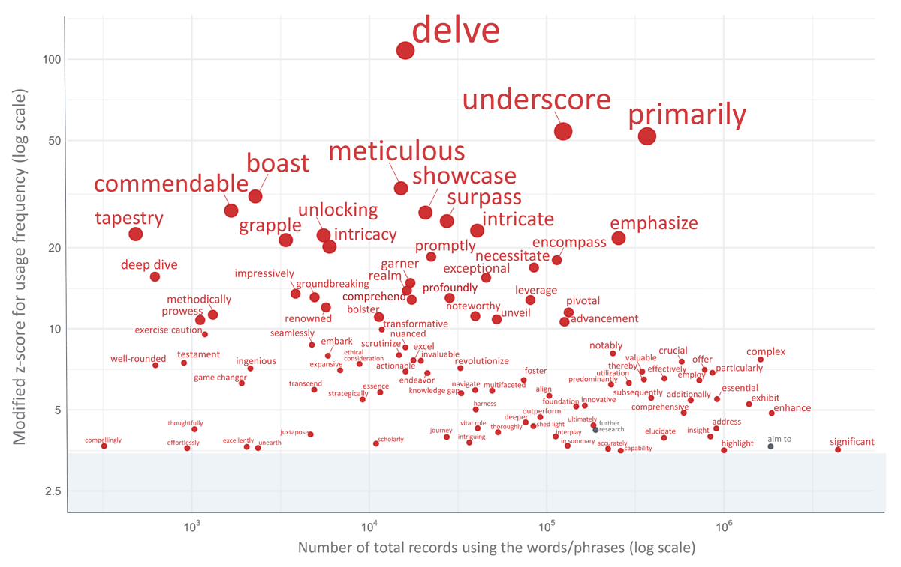

# Humanizer Academic（学术去AI味）

一个用于去除学术医学论文中 AI 生成痕迹的 skill，使文字听起来更自然、更专业。

整个 skill 就是一个文件 `SKILL.md`。它本身是一段很长的结构化提示词，因此你不必非得在 Claude Code 中使用它。

## 用法

### 在浏览器中使用（Claude、ChatGPT 或任何支持附件的工具）

1. 从本仓库下载 [`SKILL.md`](SKILL.md)。
2. 把它连同你要编辑的文本一起上传到对话中。
3. 提问：`Apply this skill to the following manuscript text: [your text]`

这样就够了，无需安装。

### 在 Claude Code 中使用

克隆到你的 skills 目录：

```bash
mkdir -p ~/.claude/skills
git clone https://github.com/matsuikentaro1/humanizer_academic.git ~/.claude/skills/humanizer_academic
```

或者，如果你已经克隆了仓库或单独下载了 `SKILL.md`：

```bash
mkdir -p ~/.claude/skills/humanizer_academic
cp SKILL.md ~/.claude/skills/humanizer_academic/
```

该 skill 会在相关场景下自动加载，因此你只需提问：

```
Please humanize this academic text: [your text]
```

## 概览

基于 [维基百科的"Signs of AI writing"](https://en.wikipedia.org/wiki/Wikipedia:Signs_of_AI_writing) 指南，针对医学和科学文献进行了改编。示例改编自 EMPA-REG OUTCOME 试验的发表文献，以及作者（K. Matsui）在学术稿件编辑过程中的观察。

### 来自维基百科的核心洞见

> "LLMs use statistical algorithms to guess what should come next. The result tends toward the most statistically likely result that applies to the widest variety of cases."
>
> 译：大语言模型用统计算法去猜测下一个该出现的词，结果往往倾向于那个适用范围最广、统计上最可能的写法。

## 检测的 34 个模式（含 Before/After 示例）

### 内容模式（Content Patterns）

| # | 模式 | Before | After |
|---|---------|--------|-------|
| 1 | **意义拔高（Significance inflation）** | "represents a pivotal challenge in the evolving landscape" | "is highly prevalent in patients with diabetes" |
| 2 | **堆砌名头（Notability claims）** | "landmark trial, led by renowned investigators" | "A total of 7020 patients..." |
| 3 | **浅薄的 -ing 分析（Superficial -ing analyses）** | "highlighting the cardioprotective effects" | 只报告数据，不做诠释 |
| 4 | **广告腔（Promotional language）** | "groundbreaking study showcases the profound impact" | "empagliflozin reduced heart failure hospitalization" |
| 5 | **模糊归因（Vague attributions）** | "Studies have shown... Experts argue..." | "In the EMPA-REG OUTCOME trial..." |
| 6 | **套话式挑战（Formulaic challenges）** | "Despite challenges... future outlook" | 陈述具体的局限性 |

> 译：表头 Before/After 列示例为英文 AI 痕迹素材，保留原文。第 1 行：意义拔高——把"在不断演变的格局中代表一个关键挑战"改为"在糖尿病患者中高度普遍"；第 2 行：堆砌名头——把"由著名研究者领衔的里程碑试验"改为"共 7020 名患者……"；第 3 行：浅薄 -ing 分析——把"凸显了心脏保护作用"改为只报告数据不做诠释；第 4 行：广告腔——把"开创性研究展示了深远影响"改为"恩格列净降低了心衰住院"；第 5 行：模糊归因——把"研究已表明……专家认为……"改为"在 EMPA-REG OUTCOME 试验中……"；第 6 行：套话式挑战——把"尽管存在挑战……未来前景"改为陈述具体局限性。

### 语言模式（Language Patterns）

| # | 模式 | Before | After |
|---|---------|--------|-------|
| 7 | **AI 词汇（AI vocabulary）** | "pivotal... landscape... crucial" | 删除或替换为简单词（注意："Additionally"每段允许出现一次） |
| 8 | **回避系动词（Copula avoidance）** | "serves as... standing as... representing" | "is" |
| 9 | **否定式平行结构（Negative parallelisms）** | "Not only X but also Y" | "X and Y" |
| 10 | **三段式（Rule of three）** | "efficacy, safety, and tolerability" | 使用自然的项目数量 |
| 11 | **同义词轮换与术语一致性（Synonym cycling & term consistency）** | "Patients... Participants... Subjects" | 全文统一用"Patients"（同一概念 = 同一术语） |
| 12 | **虚假范围（False ranges）** | "from renal function to cardiac outcomes" | 直接罗列获益 |

> 译：第 7 行：AI 词汇——删掉或替换 pivotal/landscape/crucial 等词，注意 Additionally 每段最多用一次；第 8 行：回避系动词——把"充当/代表着"改回"is"；第 9 行：否定式平行结构——把"Not only X but also Y"改为"X and Y"；第 10 行：三段式——不要硬凑三项，用自然数量；第 11 行：同义词轮换——Patient/Participant/Subject 混用要统一为 Patients，同一概念全文同一术语；第 12 行：虚假范围——把"从肾功能到心脏结局"改为直接罗列获益项。

### 样式模式（Style Patterns）

| # | 模式 | Before | After |
|---|---------|--------|-------|
| 13 | **破折号清零（Em dash elimination，零容忍）** | "benefits—a 35% reduction—appeared early—" | 改用逗号、括号或句号。所有破折号（em dash）一律删除，无例外 |
| 14 | **标题式大写（Title Case Headings）** | "Statistical Analysis And Primary Endpoints" | "Statistical analysis and primary endpoints" |
| 15 | **弯引号（Curly quotes）** | “clinically significant” | "clinically significant" |

> 译：第 13 行：破折号清零——把"benefits—a 35% reduction—appeared early—"中的破折号换成逗号、括号或句号，所有 em dash 一律删除无例外；第 14 行：标题式大写——把标题中每个实词首字母都大写的写法改为句式大小写（仅首字母大写）；第 15 行：弯引号——把弯引号替换为直引号。

### 填充词与对冲措辞（Filler and Hedging）

| # | 模式 | Before | After |
|---|---------|--------|-------|
| 16 | **填充词（Filler phrases）** | "In order to", "Due to the fact that" | "To", "Because" |
| 17 | **冗余的多层对冲（Redundant multi-layered hedging）** | "may suggest... have the potential to confer" | "suggest... may reduce"（保留 1–2 层对冲即可） |
| 18 | **空泛结论（Generic conclusions）** | "The future looks bright" | 给出具体的发现与启示 |

> 译：第 16 行：填充词——把"In order to/Due to the fact that"改为"To/Because"；第 17 行：冗余多层对冲——把"may suggest... have the potential to confer"压缩为"suggest... may reduce"，保留 1–2 层对冲；第 18 行：空泛结论——把"前景一片光明"改为具体发现与启示。

### LLM 特有用词模式（v1.1.0）

| # | 模式 | Before | After |
|---|---------|--------|-------|
| 19 | **"linked to" → "associated with"**（视语境而定） | "has been linked to shorter sleep duration" | "has been reported to be associated with" |
| 20 | **"Beyond" → "In addition to"** | "Beyond the association with..." | "In addition to the association with..." |
| 21 | **"via" → "through"** | "obtained via the online form" | "obtained through an online form" |
| 22 | **对冲不足（Insufficient hedging）** | "may reduce the risk of..." | "may help reduce the risk of..." |
| 23 | **人为压缩的表达（Artificially condensed expressions）** | "fatigue–sleepiness cycle", "mutual reinforcement" | "cycle of fatigue and sleepiness", "a self-reinforcing cycle, with each behavior possibly exacerbating the other" |
| 24 | **"where" 作非处所连接词（non-locative connector）** | "...at the most intensive level, where almost daily use was..." | "...at the most intensive level, with almost daily use..." |
| 25 | **"yield" 作结果动词（result verb）** | "did not yield stable estimates" | "failed to produce stable estimates" |
| 26 | **细微用词修正（Minor word-choice refinements）** | "interpretations remain speculative", "speculative given the small sizes" | "interpretations are still speculative", "speculative due to the small sizes" |

> 译：第 19 行：linked to → associated with（视语境）；第 20 行：Beyond → In addition to；第 21 行：via → through；第 22 行：对冲不足——把"may reduce the risk"改为"may help reduce the risk"，补足对冲；第 23 行：人为压缩的表达——把"fatigue–sleepiness cycle/mutual reinforcement"这种生造压缩改回自然说法；第 24 行：where 作非处所连接词——把"where almost daily use was"改为"with almost daily use"；第 25 行：yield 作结果动词——把"did not yield stable estimates"改为"failed to produce stable estimates"；第 26 行：细微用词修正——remain→be-verb，given→due to。

### 衔接与连接词模式（v1.1.4–1.3.0）

| # | 模式 | Before | After |
|---|---------|--------|-------|
| 27 | **保留逻辑话语标记 + 按关系变换（不要过度删减）** | （把 "Although / Whereas / Thus / Based on these results" 一概删掉） | 保留能让逻辑显化的连接词；仅为避免机械重复，按关系（结果/对比/让步）变换，绝不为装饰而加 |
| 28 | **重新语境化过度压缩的语义联系** | "unmet needs to discuss their difficulties" | "unmet needs when it comes to discussing their difficulties" |
| 29 | **装饰性 -ly 强调副词** | "markedly reduced", "critically important", "remarkably consistent" | 删除装饰性强调词；保留功能性副词（"slightly", "consistently", "approximately"） |
| 30 | **保留连接词的编辑（绝不裸删过渡词）** | "X reduced death. The benefit appeared within months."（生硬断裂） | "X also reduced death, and this benefit appeared within months." |
| 31 | **段落衔接（旧信息到新信息流 + 段首标记）** | 编辑后句子彼此脱节 | 强制最终检查：每句话都与上一句相连；对比/延续性段首词（However / On the other hand / Overall / Taken together）保留 |
| 32 | **改写式重复（Paraphrastic repetition）** | "X is associated with Y. In other words, X may contribute to Y. That is, X plays a role in Y." | 每条论点只陈述一次；保留最具体的那个版本 |
| 33 | **无实质内容的评价句** | "This is a noteworthy finding." "This observation is of clinical significance." | 删除孤立评判句；若重要，用数据或机制说明为何重要 |

> 译：第 27 行：保留逻辑话语标记——不要把 Although/Whereas/Thus 一概删掉，只按关系变换以避免机械重复；第 28 行：重新语境化——把过度压缩的语义联系还原；第 29 行：装饰性 -ly 副词——删 markedly/critically/remarkably，保留 slightly/consistently/approximately 等功能性副词；第 30 行：保留连接词的编辑——绝不裸删过渡词，要替换或重构以避免生硬的无连词断裂；第 31 行：段落衔接——最终必查每句是否与上句相连，段首标记词要保留；第 32 行：改写式重复——同一论点只说一次，保留最具体版本；第 33 行：无实质评价句——删除"This is a noteworthy finding"等孤立评判句。

### 句子节奏（v2.0）

| # | 模式 | Before | After |
|---|---------|--------|-------|
| 34 | **句子节奏与句长波动（Sentence rhythm & burstiness）** ⭐ 影响最大 | 所有句子都是 18–22 词，全都以名词短语主语开头 | 混合短句（< 15 词）和长句（> 30 词）；用介词短语、从句、连接词变换开头 |

> 译：第 34 行：句子节奏与句长波动——不要让所有句子都是 18–22 词、全以名词短语主语开头，要混合短句（< 15 词）与长句（> 30 词），并用介词短语、从句、连接词变换句首。

> **Pattern 34 是单一影响最大的干预手段。** 在实验测试（用 desklib + Binoculars 检测器做贪心搜索循环）中，仅调整句子节奏一项，就让 AI 检测分数下降了可达成改进幅度的约 90%——超过所有词汇层面编辑的总和。它必须在词汇修正之前应用，并且装饰性副词删除（Pattern 29）必须始终与句子重构配对（实验表明：只删掉"markedly"而不做重构反而会*升高* AI 分数）。

### 应予保留的学术写作（不要标记为 AI）

该 skill 明确**保留**了那些此前被过度修正的标准学术写作：

- 过渡短语："Notably,"、"Furthermore,"、"In contrast," 等。
- 逻辑话语标记："Although"、"Whereas"、"Thus"、"Based on these results"、"As expected" 等（Pattern 27）。
- 功能性 -ly 副词："slightly"、"consistently"、"modestly"、"approximately"（Pattern 29）。
- 疑问句开头："Who selects into..."、"What predicts..." 等。
- "Additionally"每段最多一次（Pattern 7 的例外）。
- 带引用的归因短语："Prior studies have shown that..."、"Evidence suggests that..." 等。

只有当它们过度扎堆使用，或缺少支撑性引用/数据时，才会被标记。

## 完整示例

**Before（AI 腔）：**
> Heart failure represents a pivotal challenge in the evolving landscape of diabetes care, underscoring the critical importance of addressing cardiovascular comorbidities. This groundbreaking study showcases the profound impact of empagliflozin. Additionally, empagliflozin reduced the risk of hospitalization for heart failure or cardiovascular death by 34%—a remarkable finding—highlighting the cardioprotective effects of this intervention. The future looks bright for patients with type 2 diabetes.
>
> 译：心力衰竭在糖尿病护理不断演变的格局中代表着一项关键挑战，凸显出处理心血管合并症的关键重要性。这项开创性研究展示了恩格列净的深远影响。此外，恩格列净将心衰住院或心血管死亡风险降低了 34%——一项非凡的发现——凸显了该干预的心脏保护作用。2 型糖尿病患者的前景一片光明。

**After（去 AI 味后）：**
> Heart failure is highly prevalent in patients with diabetes, occurring in more than one in five patients with type 2 diabetes aged over 65 years. In the EMPA-REG OUTCOME trial, empagliflozin reduced the risk of hospitalization for heart failure or cardiovascular death by 34%. The benefit was consistent in patients with and without heart failure at baseline.
>
> 译：心力衰竭在糖尿病患者中高度普遍，在 65 岁以上的 2 型糖尿病患者中发生率超过五分之一。在 EMPA-REG OUTCOME 试验中，恩格列净将心衰住院或心血管死亡风险降低了 34%。该获益在基线时有和无心衰的患者中均一致。

## 参考文献

- [Wikipedia: Signs of AI writing](https://en.wikipedia.org/wiki/Wikipedia:Signs_of_AI_writing) - AI 写作模式的主要来源
- [WikiProject AI Cleanup](https://en.wikipedia.org/wiki/Wikipedia:WikiProject_AI_Cleanup) - 维护该清单的组织

### 示例来源

医学论文示例（Pattern 1–18）改编自：

> Fitchett D, Inzucchi SE, Cannon CP, et al. Empagliflozin Reduced Mortality and Hospitalization for Heart Failure Across the Spectrum of Cardiovascular Risk in the EMPA-REG OUTCOME Trial. *Circulation*. 2019;139(11):1384-1395. doi:10.1161/CIRCULATIONAHA.118.037778

本文依据 [CC-BY-4.0](https://creativecommons.org/licenses/by/4.0/) 许可发布。

Pattern 19–31 的示例基于作者（K. Matsui）在睡眠医学研究学术稿件编辑过程中的观察。

AI 词汇模式（Pattern 7）参考了以下论文，这些论文量化了后 ChatGPT 时代医学与科学写作中词频上升或下降的词和短语：

> Matsui K. Delving Into PubMed Records: How AI-Influenced Vocabulary has Transformed Medical Writing since ChatGPT. *Perspect Med Educ*. 2025;14(1):882-890. doi:[10.5334/pme.1929](https://doi.org/10.5334/pme.1929)

> Bao T, Zhao Y, Mao J, et al. Examining linguistic shifts in academic writing before and after the launch of ChatGPT: a study on preprint papers. *Scientometrics*. 2025;130:3597-3627. doi:[10.1007/s11192-025-05341-y](https://doi.org/10.1007/s11192-025-05341-y)

> Galpin R, Anderson B, Juzek TS. Exploring the Structure of AI-Induced Language Change in Scientific English. *Int FLAIRS Conf Proc*. 2025;38. doi:[10.32473/flairs.38.1.138958](https://doi.org/10.32473/flairs.38.1.138958)

## 作者相关工作

> Matsui K. Delving Into PubMed Records: How AI-Influenced Vocabulary has Transformed Medical Writing since ChatGPT. *Perspect Med Educ*. 2025 Dec 2;14(1):882-890. doi:[10.5334/pme.1929](https://doi.org/10.5334/pme.1929)

这是我本人写的论文。利用 PubMed 记录，我测量了 ChatGPT 等 LLM 在医学写作中倾向于过度使用某些词的频率。感兴趣的话欢迎一读！



*上图即上引论文的 Figure 1，依据 [CC-BY 4.0](https://creativecommons.org/licenses/by/4.0/) 许可转载。*

## 版本历史

- **2.1.0** - 精简 SKILL.md 的 description 以满足 `claude install-skill` 强制的 1024 字符上限。未改动任何模式或 skill 行为。
- **2.0.0** - 基于本地 AI 检测器（desklib + Binoculars）的实验验证的重大更新。新增 Pattern 34（句子节奏与句长波动：经实验验证为单一影响最大的干预手段，约占可达成 AI 分数降幅的 90%）。新增文风校准（Voice Calibration）章节并附作者参考画像。将流程升级为两遍"草稿—审查"循环，含强制的节奏检查。强化 Pattern 11，明确要求术语一致性（同一概念 = 全文同一术语）。记录了关键交互：Pattern 29 删除副词必须始终与 Pattern 34 句子重构配对（单独删除会升高 AI 分数）。
- **1.4.0** - 新增 Pattern 32（改写式重复：检测并删除由"In other words / That is / Essentially"连接的同义重述）和 Pattern 33（无实质内容的评价句：删除"This is a noteworthy finding"等不提供数据或机制的孤立评判句）。扩展 Pattern 7 词汇，新增"comprehensive"（仅限摘要用法）、"holistic"、"multifaceted"。
- **1.3.1** - 扩展 Pattern 27，按逻辑关系（结果/补充/对比/让步/原因/序列分组）变换连接词以避免机械重复，并加入防止装饰性堆砌连接词的护栏（这并非 Pattern 11 的例外）。
- **1.3.0** - 新增 Pattern 29（装饰性 -ly 强调副词：删除装饰性的"markedly/critically/remarkably"，保留功能性副词如"slightly/consistently/approximately"）、Pattern 30（保留连接词的编辑：绝不裸删过渡词——替换或重构以避免生硬的无连词断裂）和 Pattern 31（段落衔接：对旧信息到新信息流以及存留的段首标记做强制最终检查）。放宽 Pattern 7，使"Additionally"每段允许出现一次（仅过度使用才被标记）。
- **1.2.x** - 将 Pattern 26 重做为"细微用词修正"（remain → be-verb，given → due to）；新增 Pattern 27（保留逻辑话语标记）、Pattern 28（重新语境化过度压缩的语义联系），以及对"linked/associated"的视语境处理（Pattern 19）。（此前的"Underused Classical Academic Terms"模式在此次重构中退役；其词汇现已由 Pattern 7 和所引作者论文覆盖。）
- **1.1.3** - 新增 Pattern 24（"where"作非处所连接词）和 Pattern 25（"yield"作结果动词）；在 README 中加入作者论文引用与 Fig.1
- **1.1.2** - Pattern 13：破折号规则升级为零容忍删除（无例外，作为强制的最终检查步骤）
- **1.1.1** - 将压缩的名词-破折号短语与模糊抽象合并为单一的"人为压缩的表达"模式（23）
- **1.1.0** - 新增 LLM 特有用词模式（19–23），保留合法的学术短语，修正对冲措辞指引的一致性
- **1.0.0** - 针对学术医学写作改编的初始版本

## 许可证

MIT

基于 [blader/humanizer](https://github.com/blader/humanizer)。
